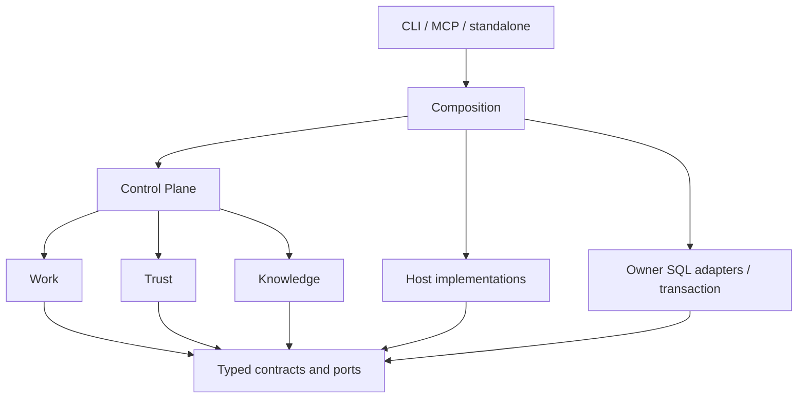

# C4 Component

Component 소유권과 import 방향은 TARGET_ARCHITECTURE가 정의한다. REQ-003~REQ-007.

화살표는 코드 의존이다. 실행 시 Kernel은 주입된 port를 통해 Host 결과를 요청할 수 있다. Host 구현을 Kernel에서 import하지 않는다. Work/Trust/Knowledge의 논리 권위는 유지하고 DB transaction은 공유한다.
