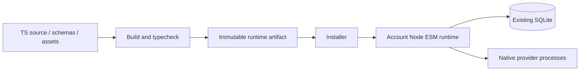

# C4 Container

Container는 배포·실행 단위를 뜻한다. 논리 모듈을 별도 서버로 만들지 않는다. REQ-007, REQ-008.

Compiler와 test runner는 개발 환경에 있다. 계정 runtime은 빌드된 코드와 필요한 실행 의존성만 사용한다. Node/SQLite는 기존 managed-runtime resolver와 연결한다. process 경계는 provider와 외부 명령 실행에 필요할 때만 사용한다.
