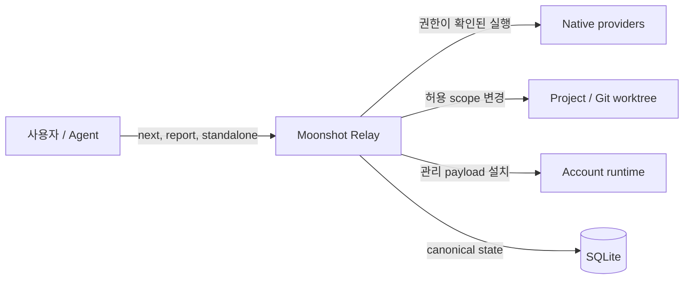

# C4 Context

System Boundary: 사용자의 프로젝트와 native provider를 연결하는 로컬 Moonshot Relay 하네스. REQ-001, REQ-006, REQ-010.

외부 provider 응답과 프로젝트 파일은 신뢰된 completion 선언이 아니다. runtime 입력 검증과 Authority 수락을 거친다. 설치와 실제 프로젝트 실행은 서로 다른 행위다.
