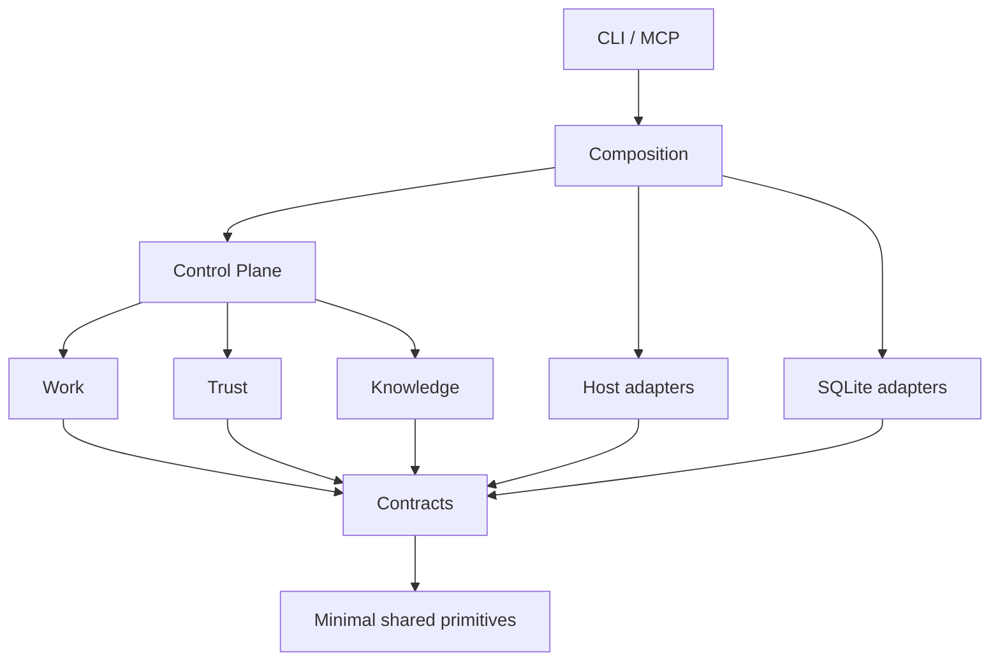

# 목표 구조와 변경 소유권

## 원칙

한 기능의 판단 권한과 상태 변경 책임을 같은 영역에 둔다. 외부 시스템을 실제 조작하는 기술은 Host가 맡는다. 이 구분은 폴더명뿐 아니라 import와 DB write 규칙으로 검사한다.

```text
src/
  contracts/             schema에서 생성한 wire 타입, 도메인 port와 command/result
  kernel/
    work/                계약, step, cursor, resume, mutation permission
    trust/               obligation, evidence, review, completion
    knowledge/           지식 수명주기, retrieval, ranking, revision
    control-plane.ts     공개 API 조정
  host/
    providers/           provider별 실행과 모델·effort 정책
    execution/           명령, process tree, timeout, network enforcement
    sessions/            native session, lifecycle, transport
    workspace/           filesystem, Git 관찰, worktree 생성·정리
    git/                 Git 조작, staging, remote parity
    prompt/              prompt compile, context budget, cache
    install/             payload, profile, account-root 설치·복구
    knowledge-input/     session parsing, 수집, 외부 입력 정규화
    codebase/            파일·Git 관찰 기반 index 생성
  persistence/           기존 SQLite 기술 adapter와 owner별 SQL 연산
  application/           standalone 도구의 use case 조합
  composition/           CLI/MCP/standalone별 dependency wiring
  cli/                   argv, JSON, stdio, exit code
  shared/                canonical digest 등 도메인 독립 primitive
schemas/                 직렬화 계약의 canonical schema
tools/                   build, contract generation, architecture check
tests/                   TypeScript 검사, 기능 회귀, package/native 검증
```

`persistence`는 기존 `state-store`의 기술 경계다. 새 데이터 권위가 아니다. `application`은 여러 공개 API를 조합해야 하는 standalone 명령에 한정한다. 모든 함수에 Service/Repository/DTO/Mapper를 추가하지 않는다.

## 소유권

| 영역 | 결정과 쓰기 책임 | 다른 영역에서 받은 입력 |
| --- | --- | --- |
| Work | task/run/step/cursor, scope, mutation revision, resume, run binding | Host의 검증 가능한 workspace 관찰, Trust decision |
| Trust | evidence requirement, evidence/review 수락, completion decision | Work의 revision/context, Host의 실행 결과 |
| Knowledge | candidate/record/review/commit/supersession/revision | Work/Trust의 구조화 신호, Host가 수집한 정제 입력 |
| Host | native session, process, workspace, Git, prompt/cache, 설치 | Work가 허용한 실행 범위, Trust의 실행 요구와 결정 |
| Persistence | owner가 승인한 typed 연산의 저장, connection/transaction | 명령과 transaction context; 정책 결정은 없음 |
| Control Plane | 명령 순서와 공개 응답 조립, transaction 조정 | 세 Authority의 command/result |

Work의 완료 진행 상태와 Trust의 수락 판정은 구분한다. Trust가 수락했다고 Host가 Knowledge를 자동 승격하지 않는다. Host가 completion을 읽고 후속 처리를 하는 것은 허용한다. Host가 필드를 쓰거나 수락 정책을 재계산하는 것은 금지한다.

## 허용 import

화살표는 importer → dependency다. 동기·비동기·type-only import에 모두 적용한다.



- Authority는 다른 Authority의 내부 파일을 import하지 않는다. cross-domain 전달은 contracts와 coordinator로 연결한다.
- Kernel은 Host 구현·provider SDK·CLI·installer를 import하지 않는다. injected port만 호출한다.
- Provider leaf는 contracts와 자신의 Host helper만 사용한다. Kernel state store 접근은 금지한다.
- Host orchestration은 contracts의 좁은 Kernel client port를 통해 결과를 전달한다. 구조 검증과 정책 수락은 별개다.
- Persistence 구현체는 composition에서 주입한다. Kernel policy를 import해서 SQL adapter가 완료 여부를 판단하지 않는다.
- `shared`는 상위 기능을 import하지 않는다. 현재 skills-lock → standalone catalog 연결은 Host install/build로 이동한다.
- 현재 MCP bridge → Host lifecycle 연결은 composition으로 이동한다.
- computed import, eval, process argv의 파일 경로도 실행 표면 registry로 관리한다. 정적 AST 검사만으로 경계 검사를 완료하지 않는다.

## Control Plane의 얇음

`next/report`는 그대로 유지한다. 아래 흐름은 책임 설명이며 새 public wire format이 아니다.

1. 입력 codec과 binding을 검증한다.
2. Work에서 현재 실행 범위와 revision을 읽는다.
3. Knowledge에서 필요한 context를 요청한다.
4. Trust에서 필요한 evidence와 현재 decision을 조회한다.
5. 필요한 실행은 승인된 Host port에 요청한다.
6. Host 결과를 받은 뒤 revision을 다시 검사한다.
7. Authority 연산을 동일 transaction에서 반영하고 응답을 조립한다.

Control Plane의 개별 함수 줄 수를 합격 기준으로 사용하지 않는다. 직접 SQL·spawn·provider 분기·개별 ranking/review policy 구현이 없는지 검사한다. 정책을 `helpers/`로 이름만 바꿔 우회하지 않는다.

## 유지보수 시험

| 시험 변경 | 핵심 변경 소유자 | 허용되는 동반 변경 | 실패 조건 |
| --- | --- | --- | --- |
| Codex 모델 선택 규칙 | host/providers/codex | 해당 fixture·정책 데이터 | Work/Trust/Knowledge 내부 수정 필요 |
| Knowledge ranking | kernel/knowledge | ranking test | provider/router/Work cursor 수정 필요 |
| completion freshness 규칙 | kernel/trust | Trust contract/회귀 | provider별 구현 수정 필요 |
| resume cursor 규칙 | kernel/work | Work fixture/회귀 | 모델 정책·지식 저장 정책 수정 필요 |

공유 public 계약이 실제로 변하는 변경은 계약 소비자를 함께 수정할 수 있다. 시험은 public 계약을 유지하는 작은 policy 변경으로 수행한다. 행 수나 파일 수의 임의 상한보다 소유권 위반을 측정한다.
